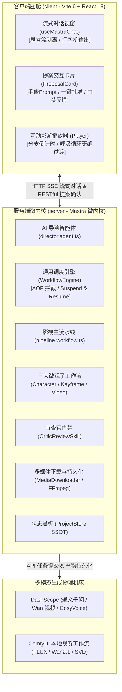

# makeMv - 互动影游与 AI 导演系统 (Interactive FMV & AI Director Engine)

> 基于 **Mastra 官方微内核**、**大模型多智能体协同** 与 **多模态视听机床** 驱动的下一代互动影游（FMV, Full-Motion Video）创作引擎。
> 采用“纯天然流式对话 + 人在回路裁决（Human-in-the-Loop） + 状态机工作流”架构，将人类创作者的灵感推演转化为高质量互动影视母带。

---

## 🌟 核心特性与架构亮点

1. **AI 导演副手与人在回路协同 (Chat-Centric & ConfirmUI)**：
   - 创作者通过自然语言与 AI 导演副手（`director-agent`）自由沟通灵感与微调意图；
   - 导演智能体主动提议生成计划并通过专有协议块抛出 `<action_proposal>`，前端打字机分离思考流，渲染交互式确认卡片；
   - 创作者在前端预览、修改提示词或参数后一键批准，杜绝黑盒失控与昂贵算力浪费。

2. **Mastra 官方微内核与通用工作流调度 (Mastra Core + WorkflowEngine)**：
   - 全面基于 `@mastra/core` 驱动，支持大模型标准化接入（兼容 OpenAI 协议与阿里百炼 DashScope）；
   - 通用 `WorkflowEngine` 状态机支持步骤前后 AOP 拦截、状态持久化、挂起（Suspend）与恢复（Resume）；
   - 解耦出 3 大专精微观子工作流（角色定妆、关键帧首样、视频切片动态生成）。

3. **7 大串行生产工序 + 横向质检门禁 (7 Pipeline Stages + Critic Gate)**：
   - **Stage 1 (故事圣经)**：世界观、黄金三幕、剧情网状因果拓扑图（DAG）与核心角色小传；
   - **Stage 2 (角色定妆)**：角色五官/服装/光影纯中文 Visual Prompt 与特征锁脸锚点；
   - **Stage 3 (分场剧本)**：场景环境描写、肢体动作、对白台词与倒计时抉择点；
   - **Stage 4 (影视分镜)**：专业导演机位、景别构图、运镜矢量与绝对时间戳；
   - **Stage 5 (关键帧参考)**：场景母板与镜头首帧高清图像渲染；
   - **Stage 6 (视频生产)**：图生视频（I2V）动态切片渲染与时长规整；
   - **Stage 7 (影游母带)**：角色多轨配音（样片先行）、呼吸循环切片、互动母带清单（`game-manifest.json`）；
   - **横向门禁 (CriticReview)**：贯穿全周期的独立审查官，执行剧情/角色/分支/视听四维质检，刚性拦截带病推进。

4. **全局统一状态黑板 (ProjectStore SSOT)**：
   - 单例门面 `ProjectStore.getInstance()` 统一管理资产（`Artifacts`）、工程元数据与会话白板；
   - 第三方媒体临时 URL 自动通过 `MediaDownloader` 持久化转存至本地永久标准化路径（`/media/:projectId/...`），支持离线永久可用。

---

## 🏗️ 整体系统拓扑



---

## 📁 目录结构导览

```
makeMv/
├── .agents/                    # 智能体核心规范法典 (AGENTS.md)
├── docs/                       # 架构设计与工程规范文档
│   ├── fmv-architecture-blueprint.md   # 系统架构与全流程蓝图 (SSOT)
│   ├── api-specification.md            # HTTP 与 SSE 接口规范
│   └── confirm-ui-workflow-checklist.md# 人在回路交互清单
├── client/                     # 现代前端：Vite 6 + React 18 + Tailwind CSS 4
│   ├── src/
│   │   ├── components/         # 交互卡片、流式对话视窗、FMV 互动播放器
│   │   ├── hooks/              # 流式对话 (useMastraChat)、提案管理
│   │   ├── lib/                # API 客户端与网络工具
│   │   └── types/              # 视图层契约与组件类型
│   └── package.json
└── server/                     # 服务端：Mastra 微内核 + 影视生成引擎
    ├── src/
    │   ├── index.ts            # 服务启动入口
    │   ├── api/                # HTTP 协议层与业务路由分发 (/chat, /projects, /proposals)
    │   ├── mastra.ts           # Mastra 微内核实例与工具容器装配出口
    │   ├── workflow-engine/    # 通用工作流调度引擎 (AOP 确认拦截切面)
    │   ├── agents/director/    # AI 总导演智能体自治域
    │   ├── tools/              # 8 大工序原子工具族 (story-bible, storyboard 等)
    │   ├── media/              # 视听持久化与 Provider (MediaDownloader, FFmpeg)
    │   ├── llm/                # 统一大模型注册表 (LLMRegistry)
    │   ├── project-store/      # 全局状态黑板层 (ProjectStore)
    │   └── types/              # 全局业务与工序数据契约
    ├── tests/                  # 单元测试与轻量冒烟测试矩阵
    └── package.json
```

---

## 🚀 快速开始

### 1. 环境准备
- Node.js >= 18.0.0
- npm / pnpm
- （可选）本地 FFmpeg 工具（用于高级音画剪辑与转码）

### 2. 依赖安装
分别在根目录安装服务端与客户端依赖：
```bash
# 安装服务端依赖
cd server
npm install

# 安装客户端依赖
cd ../client
npm install
```

### 3. 环境配置
在 `server/` 目录下创建 `.env` 文件，配置必要的大模型与媒体机床密钥：
```ini
PORT=3000

# 大模型配置 (默认阿里百炼 DashScope / OpenAI 兼容协议)
DASHSCOPE_API_KEY=your_dashscope_api_key_here
LLM_PROVIDER=dashscope

# 本地工程资产持久化目录 (默认相对于 server)
PROJECTS_ROOT=./projects
```

### 4. 启动服务
```bash
# 启动服务端 (监听 3000 端口)
cd server
npm run dev

# 在新终端启动客户端座舱 (监听 5173 端口)
cd client
npm run dev
```

访问 `http://localhost:5173` 即可进入 AI 导演交互座舱。

---

## 🧪 静态检查与测试

服务端全面遵循强类型驱动与 0 警告交付标准：
```bash
# 执行服务端 TypeScript 静态编译检查
npm run build --prefix server

# 运行服务端测试套件
npm run test --prefix server
```

---

## 📖 相关文档
- [系统架构与全流程蓝图 (Blueprint)](docs/fmv-architecture-blueprint.md)
- [API 协议规范与接口契约](docs/api-specification.md)
- [ConfirmUI 人在回路清单](docs/confirm-ui-workflow-checklist.md)
- [AI 助手核心开发法典](.agents/AGENTS.md)
