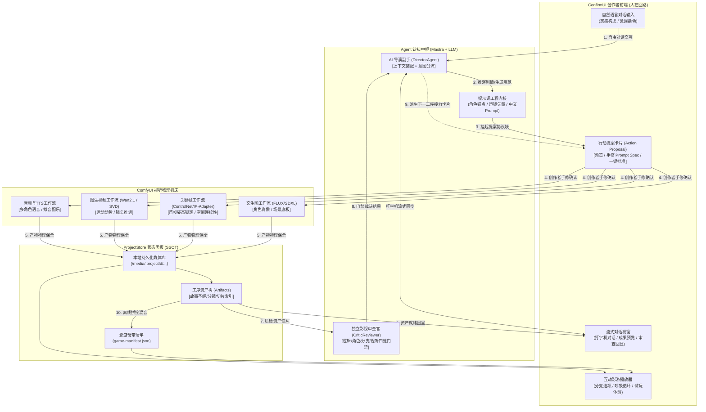

# makeMv 互动影游系统架构与全流程实现工程蓝图
> **Interactive FMV Engine: Complete Architecture & Stage Blueprint**  
> **定位说明**：本文档是指导 makeMv 互动影游与 AI 导演系统架构演进、智能体微内核调度、ConfirmUI 人机协同与 ComfyUI 视听机床落地的唯一事实来源（SSOT）。

---

## 一、 核心定位与分工拓扑 (Core Positioning & Topology)

系统由四大核心主体协同构成，形成“认知推演 ➔ 人机裁决 ➔ 物理机床 ➔ 状态落盘”的高内聚分工闭环：

```
                    ┌────────────────────────┐
                    │ 人类创作者 (Creator)    │
                    └───────────┬────────────┘
                                │ (自然语言交流 / 审查手修 Prompt)
                                ▼
                    ┌────────────────────────┐
                    │ ConfirmUI 交互前端     │
                    └───────▲────────┬───────┘
  (打字机对话/产物回显/卡片呈现) │        │ (一键批准 / 靶向指令)
                            │        ▼
┌───────────────────────────┴────────┴────────┐
│ Agent 认知中枢 (Mastra + LLM)               │
│ - 剧情分支推演 / 运镜规划 / 影视级 Prompt Spec │
│ - 阶段感知与行动提案 (Action Proposals)       │
└───────────────────────────┬─────────────────┘
                            │ (注入结构化提示词包与特征张量)
                            ▼
┌─────────────────────────────────────────────┐
│ ComfyUI 视听生成物理机床                    │
│ - 消费 Prompt / IP-Adapter / ControlNet     │
│ - 运行 T2I/I2V 节点工作流渲染高清图像与视频   │
└───────────────────────────┬─────────────────┘
                            │ (异步生成通知 / 物理切片落盘)
                            ▼
┌─────────────────────────────────────────────┐
│ ProjectStore 全局唯一状态黑板 (SSOT)        │
│ - 全剧工序资产 (Artifacts) / 本地媒体库     │
│ - 影游母带清单 (FMVManifest) 编译与持久化   │
└─────────────────────────────────────────────┘
```

### 1. 四大核心主体职责边界
1. **Agent（Mastra + LLM）—— 大脑认知中枢**：
   - 负责长程剧本叙事推演、分支抉择因果树规划、影视机位运镜设计；
   - 核心输出为标准强类型的影视级结构化提示词包（Prompt Spec，涵盖正负词、构图景别、动作矢量与控图张量）；
   - 结合全局状态黑板进行阶段语义路由与自主行动提案。
2. **ComfyUI —— 视听生成物理机床**：
   - 专注作为纯粹的重算力执行端，不包含任何业务剧本逻辑；
   - 消费 Agent 合成的结构化 Prompt Spec 以及参考图特征张量，执行 T2I（文生图/定妆照）、I2V（图生视频）、ControlNet 姿态/深度控制及音频合成工作流；
   - 输出真实高清图像、视频分段切片与音频资产。
3. **ConfirmUI —— 创作者交互前端（人在回路 Human-in-the-Loop）**：
   - 提供纯天然流式打字机交互界面，承载创作者自由自然语言意图；
   - 在触发重度算力生成或工序跃迁前，将 Agent 的行动提案渲染为直观的交互卡片；
   - 创作者可直观预览、微调或手修 Prompt Spec 参数，完成一键批准（Confirm）或发起自然语言修改。
4. **ProjectStore —— 全局唯一状态黑板（SSOT）**：
   - 全局唯一状态聚合根与物理持久化中枢，统管会话历史、工序资产（`Artifacts`）与工程元数据；
   - 统一拉取机床生成的临时媒体流并固化为本地永久规范路径（`/media/:projectId/...`）；
   - 负责最终互动母带（`game-manifest.json`）的离线编译与双缓冲播放器交付。

---

## 二、 整体架构流程图 (Mermaid Architecture)



---

## 三、 核心机制一：对话流驱动与流入工作流机制

### 3.1 为什么核心主线采用对话流驱动？
传统固定流水线（Pipeline）采用僵硬的前后串行编排，存在两大致命缺陷：
1. **阻断真实创作涌现**：互动影视创作是高度迭代的艺术，创作者经常需要在分镜阶段反思世界观、在看图后微调角色设定；
2. **缺乏拟人化导演协同**：创作者需要的是经验丰富的“AI 导演副手”，能用自然语言交流探讨剧作意图、提出建设性修改，而非死板的表单提交器。

因此，系统全面转向以**纯天然流式对话为主线（Chat-Centric）、动态技能微内核（Skills Microkernel）为基座**的现代协同范式。

### 3.2 对话流流入工作流全链路运转闭环
创作者的自然语言在系统内部按照如下 6 步标准协议闭环演进为物理计算：

```
[自然语言输入] 
      │ 
      ▼ (语义识别与槽位提取)
[阶段定位 & 技能分流] 
      │ 
      ▼ (合成强类型参数结构体)
[挂起提案卡片 (Action Proposal)] 
      │ 
      ▼ (创作者预览 / 手修 Prompt Spec)
[人在回路批准 (Authorized Execution)] 
      │ 
      ▼ (结构化 Prompt 注入机床)
[ComfyUI 异步工作流渲染] 
      │ 
      ▼ (媒体保全落盘与状态黑板同步)
[资产落盘 & 对话流打字机回显]
```

1. **自然语言输入（Natural Language Input）**：
   创作者在 ConfirmUI 输入自由指令（例如：“把李默的服装换成带磨损痕迹的深灰工装皮夹克，重绘定妆照”）。
2. **语义识别定位工序与语义槽位提取（Semantic Routing & Slot Extraction）**：
   - `DirectorAgent` 结合当前项目阶段记忆与历史 Turns 展开推理；
   - 精准定位目标工序（如 `CharacterPortraitSkill`），并提取目标实体（角色：“李默”）与变动属性（服装：“带磨损痕迹的深灰工装皮夹克”）。
3. **挂起行动提案卡片（Pending Action Proposal）**：
   - 模型在流式输出中通过专有协议块抛出行动提案：
     `<action_proposal type="render_character" payload="{...}">`；
   - 服务端 `StreamTagParser` 实时拦截协议块，分离出纯自然语言思考流与强类型数据负载，在前端生成生命周期为 `pending` 的交互确认卡片。
4. **创作者预览与手修 Prompt Spec（Creator Review & Fine-Tuning）**：
   - 交互卡片清晰展示生成的正向 Prompt、负向 Prompt、采样参数与参考特征图；
   - 创作者可直接在卡片内修改任何文字或权重（人在回路），杜绝模型黑盒失控乱跑。
5. **批准执行注入 ComfyUI（Authorized Execution to ComfyUI）**：
   - 创作者点击“批准生成”或下发指令，触发后端技能调度器；
   - 技能模块将确认后的结构化 Prompt Spec 映射为 ComfyUI 专有 API 节点工作流 JSON，提交至机床任务队列。
6. **产物落盘并在对话流回显（Persistence & Chat Echo Feedback）**：
   - 机床渲染完毕后，`MediaDownloader` 将图像/视频持久化落盘至本地工程目录，更新 `ProjectStore` 对应资产槽位；
   - 系统向对话流推送资产就绪消息与缩略图卡片，AI 导演副手以打字机形式向创作者呈递生成结果与视听分析。

---

## 四、 核心机制二：完成后自动推进与接力机制

### 4.1 底层断点感知与工序自动派生
每个工序完成后，系统依靠 **ProjectStore 单一事实来源（SSOT）** 进行确定性状态机检查：
- **工序完备度契约校验**：底层状态机校验当前工序的标准产物是否齐备且符合 Schema（例如：Stage 2 必须所有核心主角定妆图落盘且已绑定 Visual Spec）；
- **动态推导下一断点工序**：当判定当前工序已收敛（`COMPLETED`），状态机根据工序依赖图自动推导出下一个待执行断点工序（如 Stage 2 完成后，自动派生 Stage 3 分场文学剧本拆解）。

### 4.2 AI 导演主动汇报与“一键继续”接力卡片
工序收敛后，系统坚决杜绝静默假死或强行自动扣动高昂算力扳机，而是采用**主动汇报 + 呈递接力提案**：
1. **对话流主动汇报**：AI 导演副手在对话流中输出富有影视专业素养的阶段成果总结（如汇总角色视觉定妆亮点、场景基调提炼）；
2. **呈递接力提案卡片**：伴随总结，模型主动呈递带有 `<action_proposal type="advance_stage" nextStage="SceneScript">` 的接力卡片；
3. **一键确认推进**：卡片上醒目标注“进入分场剧本拆解（Stage 3）”的【一键继续 (Continue)】按钮，创作者可随时一键推进，亦可随时在输入框中追加补充意图进行反复打磨。

### 4.3 独立审查官（Critic Reviewer）放行门禁守卫
在工序交接与母带生成等关键节点，独立审查官执行**跨工序客观穿透审计与代码级刚性门禁**：

```
[工序成果产出] ──► [CriticReviewer 独立审计 (四维雷达图打分)]
                           │
         ┌─────────────────┼─────────────────┐
         ▼                                   ▼
 [综合分 ≥ 80 且无硬伤]              [综合分 < 60 或有致命硬伤]
      (PASS 放行)                         (FAIL 刚性拦截)
         │                                   │
         ▼                                   ▼
[放行接力提案卡片]                   [阻断工序跨阶段跃迁]
[创作者可一键推进至下一阶段]           [倒逼定向自愈 / 仅放行当前工序微调]
```

- **三级门禁裁决标准**：
  - **PASS（综合分 ≥ 80 且无致命硬伤）**：门禁无阻放行，正常呈递下一阶段接力卡片；
  - **WARN（综合分 60~79）**：出具备忘录级别的自愈改进建议，但卡片打上警示标记，允许创作者知情后自主选择一键放行；
  - **FAIL（综合分 < 60 或包含逻辑自相矛盾等硬伤）**：**代码级刚性阻断跨阶段跃迁提案**，坚决拦截带病推进后续工序。
- **自愈重推放行准则**：
  - 当处于 FAIL 状态时，门禁坚决拦截“推进下一阶段”类的提案；
  - 但对于针对当前阶段的自愈优化指令、微调重绘提案或创作者的辩护申诉，门禁坚决予以放行，形成“阻断 ➔ 诊断反思 ➔ 定向自愈 ➔ 达标放行”的高健壮性工程闭环。

---

## 五、 8 大工序阶段大纲表 (The 8 Stages Overview)

以下为互动影游从零到母带交付的 8 大宏观工序大纲（保持宏观规范，严禁在文档中冗余倾倒低信噪比底层算法代码）：

| 阶段编号 | 工序名称与定位职责 | 核心输入依赖 | 核心输出资产契约 |
| :--- | :--- | :--- | :--- |
| **Stage 1** | **故事圣经与世界观架构 (StoryBible)**<br>文本大模型认知推演，确立全剧宏观骨架、黄金三幕节拍、角色小传与网状互动抉择图。 | 创作者灵感种子 (`idea`)、影视风格偏好 (`style`) | `story_bible.md`、角色小传档案、剧情连通拓扑图 (`StoryGraph DAG`，含节点与有效抉择分支)。 |
| **Stage 2** | **角色定妆照与视觉锚点 (CharacterPortrait)**<br>多模态提示词工程 + 文生图机床，确立并固定角色五官、发型、服装材质与光影视觉基准。 | Stage 1 角色小传清单、整体艺术风格设定 | 角色高清定妆图集、标准纯中文 Prompt Spec、角色特征锁脸锚点（IP-Adapter / Face Embedding）。 |
| **Stage 3** | **分场文学剧本拆解 (SceneScript)**<br>文学剧本扩写，充实各剧情节点的具体场景时空、行动指示、肢体反应、台词对白与分支倒计时点。 | Stage 1 剧情网状拓扑节点、Stage 2 角色视觉档案 | 结构化分场文学剧本 (`scene_scripts.json`)，标明每个节点的场景环境、对白台词及情绪提示。 |
| **Stage 4** | **影视分镜与镜头语言规划 (Storyboard)**<br>专业导演机位规划，将文学场景切分为标准分镜头表，规范景别、构图、运镜矢量与预估时长；为互动镜头打标，自动计算推导出母带交互倒计时弹出的绝对时间戳 (`decisionWindow.startSec`)。 | Stage 3 分场文学剧本、导演视听运镜原则 | 影视分镜头清单 (`shots.json`)，包含每个镜头的景别（特写/中景/全景）、运镜轨迹与分镜提示词。 |
| **Stage 5** | **关键帧参考图与场景母板渲染 (KeyframeReference)**<br>多模态控图机床，生成分镜首帧高清画面；通过场景母板与 ControlNet 确保机位透视与空间一致性。 | Stage 4 分镜头表、Stage 2 角色特征锚点、场景母板 | 各镜头首帧高清参考图 (`keyframes/shot_{id}.png`)，人物姿态与场景透视严格匹配分镜规约。 |
| **Stage 6** | **动态视频切片生成 (VideoProduction)**<br>ComfyUI 图生视频（I2V）物理机床，以静态首帧参考图为底版，注入运镜动势参数渲染高清视频切片。 | Stage 5 关键帧首帧图、Stage 4 镜头运动矢量与时长 | 高清无水印动态视频切片库 (`videos/clip_{id}.mp4`，24fps，时长符合镜头规划)。 |
| **Stage 7** | **影视审查官质检与双轨门禁 (CriticReview)**<br>**双轨机制**：既作为贯穿 Stage 1~6 的横向伴随门禁（Checkpoint Gate），又作为母带打包前的全景终审（Master Comprehensive Audit），执行剧情因果、角色行为、分支有效性与视听一致性四维裁决。 | 全链路工序资产快照（剧本、定妆照、分镜表、视频切片） | 独立四维质检报告（雷达评分 + 致命硬伤清单 + 自愈修复建议），输出门禁裁决 (`PASS` / `WARN` / `FAIL`)。 |
| **Stage 8** | **影游母带装配与播放器打包 (FmvPackaging)**<br>视听工程混流拼接；TTS 人声遵循“样片先行”原则，在 ConfirmUI 试听锁定角色音色听觉锚点后再行三轨混音合成；渲染决策待机呼吸循环短视频并编译互动播放清单。 | Stage 1 分支因果路由、Stage 6 视频切片、Stage 3 对白文本 | 剧情节点主视频、决策待机呼吸循环切片 (`idleLoopUrl`)、标准影游互动母带清单 (`game-manifest.json`)。 |

---

## 六、 核心数据契约大纲 (Core Data Contracts)

### 1. 剧情节点资产契约 (FMVNodeAsset)
```typescript
interface FMVNodeAsset {
  nodeId: string;              // 剧情节点唯一标识
  title: string;               // 剧情小节标题
  videoUrl: string;            // 服务端离线拼接混音后的主视频切片 URL
  idleLoopUrl?: string;        // 等待玩家抉择时的 3~5 秒无缝呼吸待机短视频
  durationSec: number;         // 节点主视频总时长
  decisionWindow?: {
    startSec: number;          // 互动选项弹出的起始时间戳 (秒)
    timeoutSec: number;        // 决策倒计时时长
    defaultChoiceId: string;   // 超时未选择时的默认保底选择
  };
  isDecisionPoint: boolean;    // 是否为玩家抉择点
  choices?: FMVChoice[];       // 互动选项分支列表
}
```

### 2. 互动分支与变量契约 (FMVChoice)
```typescript
interface FMVChoice {
  id: string;                  // 选项 ID
  fromNodeId: string;          // 出发剧情节点
  toNodeId: string;            // 目标剧情节点
  choiceText: string;          // 选项 UI 展示文案
  conditions?: {               // 隐藏因果变量解锁条件
    requiredClues?: string[];  // 必需线索
    minAffinity?: Record<string, number>; // 角色好感度门槛
  };
}
```

### 3. 行动提案契约 (ActionProposal)
```typescript
interface ActionProposal {
  id: string;                                          // 提案唯一标识
  type: 'render_portrait' | 'render_keyframe' |        // 提案动作类型
        'render_video' | 'advance_stage' | 'regenerate';
  title: string;                                       // 卡片标题
  description: string;                                 // 提案意图描述
  status: 'pending' | 'approved' | 'rejected';         // 提案生命周期状态
  stage: string;                                       // 所属工序阶段
  payload: Record<string, any>;                        // 提示词 Spec 与机床执行参数负载
}
```

---

## 七、 顶层架构与实施准则 (Guiding Principles)

1. **单一事实来源与源头治理（SSOT & Zero Aliasing）**：
   - 依赖 `ProjectStore` 作为全剧唯一状态黑板，彻底根除深层对象层层透传引发的属性丢失；
   - 严禁在对象传参中保留同义字段或历史别名；遇到契约变更一律从源头 Prompt 与 Schema 重构，下游消费端零兼容容错。
2. **纯中文提示词规范体系**：
   - 全链路生图、生视频与微调体系采用标准纯中文结构化提示词架构（`prompt.ts` 内中文提示词架构），杜绝遗留英文拼凑。
3. **彻底的系统级通用性（Zero Hardcoding）**：
   - 系统核心微内核、分镜装配与校验器对悬疑、科幻、历史、治愈等任何题材完全通用，严禁将具体题材名称或角色硬编码到业务分支中。
4. **真实视听文件闭环验收**：
   - 图像与视频切片必须确保本地磁盘真实文件物理写入完整（`fs.existsSync` 且 `fileSize > 0`），转化为永久规范路径，坚决杜绝“无报错假成功”。
5. **刚性阻断优于隐式苟且（Fail-Fast Over Silent Degrade）**：
   - 审查官门禁与强类型校验发现破损数据时坚决阻断并倒逼上游自愈，严禁在消费端通过伪造静态假剧情欺骗创作者。
